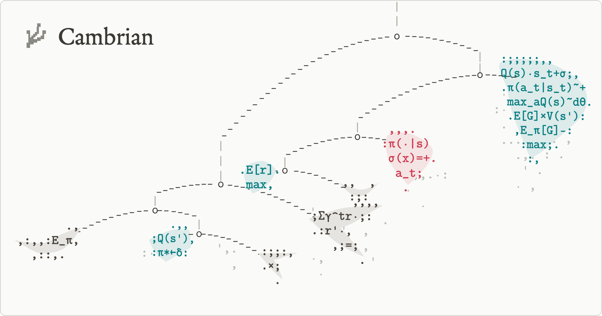

<p align="center">
  
</p>

# Cambrian

A research workshop for people taking asymmetric bets in robot learning.

We're a small group of engineers and roboticists exploring ideas that are newly within reach. Most of us
are Stanford researchers who also work in labs like [ILIAD](https://iliad.stanford.edu/),
[REAL](https://real.stanford.edu/), and [Hazy Research](https://hazyresearch.stanford.edu/).

## Why now

The economics and the possibilities of robotics research are shifting. Running an experiment used to take
weeks: integrating components from several vendors, calibrating poses, and fabricating a test rig.
Frontier AI has collapsed the cost of software and is beginning to do the same for parts of hardware. Most
of the setup is no longer the bottleneck. Frontier models are also showing strong spatial reasoning,
enough to generate realistic 3D environments and even actuate robots directly, and we think much of the
field still underestimates what they can unlock when used creatively. Together, these mean that testing a
strange idea now costs a fraction of what it did even a few months ago. Directions that once needed a
well-funded lab and years of infrastructure are now within reach of a small group with a good idea and the
will to pursue it.

## The name

The name comes from the [Cambrian explosion](https://en.wikipedia.org/wiki/Cambrian_explosion), when, over
a short stretch of geological time, life went from simple, soft-bodied organisms to most of the animal body
plans alive today. We think robots are nearing a similar moment. As one model learns to control whatever
body it is given, and building that body gets cheap, the shape of a robot stops being a fixed bet. We want
to help that happen. The point is not to commercialize our work, but to provide the space, resources, and
people to explore it seriously.

## Early directions

- **Unexplored end effectors and dexterous tool use.** The field has mostly converged on parallel-jaw
  grippers and dexterous hands. The space of possible bodies, and of ways to collect data for them, is
  much larger than what's been tried.
- **Automating the [novelty pump](https://vedder.io/misc/novelty_pump.html).** A robot policy only
  improves from data that shows it something new, and finding that data today is manual work that doesn't
  compound. We think frontier models can take over parts of this loop, from spotting failures to
  generating new scenarios, toward a true data flywheel where every hour of deployment makes the policy
  better.
- **Embodied alignment.** Making sure robots act in ways that follow our intent, including the parts we
  don't think to specify.

## Get in touch

If you have a bet you want to test and Cambrian sounds appealing, we'd like to hear from you. You don't
need to be at Stanford or in a lab. Labs and companies interested in sponsoring research or learning more
are welcome too. Email us at [mmusic@stanford.edu](mailto:mmusic@stanford.edu).

## This repository

Cambrian's work will live here. For now, it holds the landing page at [atelierlab.io](https://atelierlab.io),
a Next.js site: one column of text beside an ASCII-art sculpture after Alexander Calder's
[*Model for East Building Mobile*](https://www.nga.gov/artworks/55697-model-east-building-mobile) (1972).
The sculpture is a small physics simulation of a balanced mobile, printed in reinforcement-learning
notation, that drifts in a slow air current and stirs when the cursor moves across it. Behind both, a
contour map of a rolling terrain is printed in typewriter dashes and periods, clearing softly around the text
and the sculpture. Gentle waves run along its lines, and now and then one flashes orange or teal.

```bash
npm install
npm run dev     # http://localhost:3000
```

The text is in `components/Copy.tsx`, the title and share image in `app/layout.tsx`, the colors in
`app/globals.css`, the sculpture in `components/mobile/`, and the background in `components/field/` (each
keeps its tuning knobs in `config.ts`). The page is set in Legitima, served from the committed
`public/fonts-local/font.ttf` file. The sculpture and the background are printed in CMU Typewriter.
